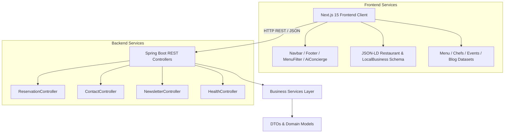

# PORTFOLIO CASE STUDY: RASOI MAHAL - The Royal Taste of India 👑

---

## 🎯 Business Problem
Premium Indian fine-dining restaurants face a significant digital branding challenge: most restaurant websites use generic Western templates that fail to convey authentic Indian heritage, cultural richness, or royal luxury within the first 3 seconds of a visitor's arrival. Furthermore, standard restaurant websites lack interactive features such as multi-topic AI concierge assistance, Jain-specific menu filtering, or seamless wedding and corporate catering portals.

---

## 💡 Solution
**RASOI MAHAL** was architected as a bespoke, ultra-luxurious digital flagship. Drawing deep visual inspiration from Royal Rajasthan, Mughal court architecture, hand-carved Jharokha screens, and 28 years of Mewari culinary heritage, the platform delivers an immersive cultural experience paired with modern web engineering.

---

## 🔑 Key Features & Technical Highlights

### 1. Indian Royal Aesthetic & Design System
- **Curated Royal Palette**: Royal Maroon (`#4A0E17`), Royal Gold (`#D4AF37`), Deep Saffron (`#FF9933`), Ivory (`#FFFDF6`), and Charcoal Black (`#121212`).
- **Typography**: Dual-font design system utilizing Playfair Display / Cinzel for royal headings and Plus Jakarta Sans for crisp readability.
- **Architectural Motifs**: Custom SVG Rajasthani Jaali dividers, golden border accents, arch-top framing, and subtle floating spice particle canvas animations (saffron threads and gold dust).

### 2. In-App AI Concierge Assistant ("Mahal Concierge")
- Intelligent conversational assistant covering 16 distinct topics (Reservations, Jain options, Chef recommendations, Wedding catering, Corporate banquets, Parking, Wine pairings).
- Direct WhatsApp handoff integration (`NEXT_PUBLIC_WHATSAPP_NUMBER`) for instant staff communication.

### 3. Comprehensive 18-Page Architecture
- **Home**: Hero banner, signature dish carousel, traditional silver thali showcase, regional cuisine highlights, private dining & catering previews, patron reviews, gallery grid, and CTA.
- **Menu**: Categorized by North Indian, South Indian, Punjabi, Maharashtrian, Gujarati, Rajasthani, Hyderabadi Biryani, Tandoor, Street Food, Desserts, Beverages, with live search, spice level indicators, and dish detail modals.
- **Reservation**: Multi-step booking form connected to Spring Boot REST backend with graceful offline fallbacks.
- **Specialized Portals**: Dedicated portals for Chef Team, Private Dining Suites, Wedding Destination Catering, Corporate Banquets, Events, Gallery, Testimonials, Blog System, FAQs, Contact, Privacy Policy, Terms, and custom Royal 404.

---

## 🏛️ System Architecture

---

## 🛠️ Technology Stack Breakdown

| Layer | Technology | Usage / Purpose |
|---|---|---|
| **Frontend Framework** | Next.js 15 (App Router) | Server-Side Rendering, Static Generation, Route Handling |
| **Language** | TypeScript | Type safety across components and API models |
| **Styling** | Tailwind CSS v4 + Vanilla CSS | Design system tokens, royal gradients, glassmorphism |
| **Icons** | Lucide React | High-performance SVG icons |
| **Backend Framework**| Spring Boot 3.2.x | REST API server |
| **Language** | Java 21 | High-efficiency JVM backend |
| **Validation** | Jakarta Validation | `ReservationRequestDto`, `ContactRequestDto` data verification |
| **SEO** | JSON-LD & Dynamic Metadata | Google Rich Snippet indexing for local business |

---

## 🖼️ Screenshots Placeholder

- `[Screenshot: Royal Hero Banner & Navbar]`
- `[Screenshot: Interactive Menu Filter with Spice Indicators]`
- `[Screenshot: Mahal Concierge AI Chatbot Drawer]`
- `[Screenshot: Reservation Booking Form]`
- `[Screenshot: Traditional Thali Showcase Section]`

---

## 🔮 Future Scope
1. **Interactive 3D Table Reservation**: Drag-and-drop table selection map based on actual floor plans.
2. **Payment Gateway Integration**: Advance deposit lock-in for private suites via Razorpay/Stripe.
3. **Multi-Language Concierge**: Real-time translation into Hindi, French, and German.
